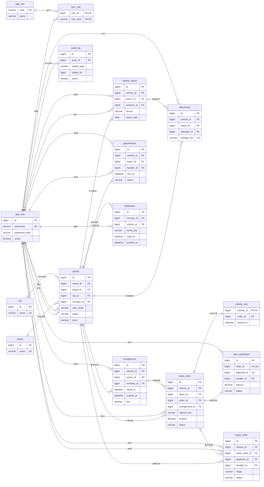

# 二手车交易管理系统数据库设计

系统以车辆档案为中心，共使用 16 张表。用户使用同一个账号发布车辆和购买车源。直销和代销共用车辆档案，代销额外保存委托。成交、贷款和送修记录通过车辆编号或订单编号关联。

## 数据表

| 业务 | 表 | 用途 |
| --- | --- | --- |
| 账号与权限 | `app_user` | 保存用户名、口令散列、显示名称和账号状态。 |
| 账号与权限 | `app_role` | 保存普通用户、工作人员和管理员三种角色。 |
| 账号与权限 | `user_role` | 为一个账号分配一个或多个角色。注册时分配普通用户角色。 |
| 基础数据 | `brand` | 保存品牌字典，供车辆录入和筛选使用。 |
| 基础数据 | `city` | 保存城市字典，供车辆录入和筛选使用。 |
| 车源 | `vehicle` | 保存发布人、品牌、车型、城市、车龄依据、里程、报价、经营方式和审核上架状态。 |
| 代销 | `consignment` | 保存委托人、有效期、费用、约定和审核结果。一辆车可以保留多份历史委托。 |
| 车况 | `vehicle_report` | 保存查博士等车况报告的来源、日期、摘要、录入人与审核结果。 |
| 车况 | `attachment` | 保存车源照片和报告附件的文件标识及元数据。文件存放在独立目录。 |
| 预约 | `appointment` | 保存预约车辆、预约人、到访时间、经办人和处理结果。 |
| 交易 | `trade_order` | 保存买卖双方、成交金额、委托引用和订单历史，记录模拟支付和过户确认时间。 |
| 交易 | `vehicle_lock` | 记录当前占用车辆的订单。同一辆车最多一条锁记录。 |
| 贷款 | `loan_application` | 保存买方的贷款申请、期限、经办人及办理进度。一个订单最多一份申请，补充资料更新原申请。 |
| 送修 | `repair_order` | 保存售前整备和售后送修记录，售后工单绑定同一辆车的成交订单。 |
| 通知 | `notification` | 保存接收人、事件标识、消息、已读时间和在线推送重试进度。 |
| 审计 | `audit_log` | 保存审核、成交、工单和权限变更等关键操作，可按操作人、时间和业务编号查询。 |

按状态汇总车源、订单和待办时直接查询业务表。审核、工单和交易的历史变更可通过业务记录与操作日志查询。

## ER 图

图中圆圈表示可为空，双竖线表示恰好一个，分叉表示可关联多条记录。字段旁的 `PK` 和 `FK` 分别表示主键和外键。复合外键的字段顺序以建表脚本为准。



订单卖方和委托人通过车辆编号与发布人组成的复合外键确定。贷款申请人通过订单号与买方组成的复合外键确定。代销订单、报告附件、售后工单和车辆锁定都使用复合外键检查车辆归属。日志与通知的 `subject_type` 和 `subject_id` 用于记录业务来源，接收人、关联车辆和操作人使用独立外键。

## 关键约束与事务

- **锁车与重试。** 下单事务先用 `UPDATE vehicle SET status = 'LOCKED' WHERE id = ? AND status = 'LISTED'` 争抢同一辆车，只有更新成功的请求才能继续写入订单、锁记录及通知。任何一步失败都回滚。用 `(buyer_id, request_key)` 识别重试，返回同一请求的原订单，并校验请求内容与原请求一致。
- **取消与成交。** 取消或成交需要在事务中按车辆号和订单号核对当前锁记录。取消时根据审核、上架和委托条件决定车辆恢复可售还是转为下架，成交时将车辆更新为已售。订单历史一直保留。
- **直销与代销。** 直销订单的委托编号为空。代销下单时由服务检查委托已审核且处于有效期内，并把使用的委托写入订单。允许的状态转换、同一时点生效的委托及到期或撤回后的处理由服务统一判断。
- **贷款与送修。** 售后工单须引用该车的订单，并由该订单买方发起。服务还需校验订单已成交、操作者有权限。售前工单按车辆办理。贷款金额和期限的基本范围由数据库检查，金额与订单的关系以及办理状态由服务校验。
- **通知与权限。** 业务更新与通知记录同一事务提交，事务提交后再推送。通知通过 `(receiver_id, event_key)` 去重，在线推送失败时安排重试，离线用户可从站内列表补读。后端按角色及记录归属检查接口和附件访问。
- **查询与保存。** 车辆筛选索引围绕上架状态、品牌、价格、城市、年份、里程和上架时间建立。停用账号和下架车辆使用状态字段，外键保留关联的历史记录。

## 初始化数据库

[建表 SQL](../backend/src/main/resources/schema.sql) 是 Spring Boot 的初始化脚本，适用于空数据库。脚本预置三种角色，账号和业务演示数据可随后独立导入。

使用 MySQL 8.0.16 或更新版本，在 MySQL 客户端先创建并选中数据库。

```sql
CREATE DATABASE IF NOT EXISTS used_car CHARACTER SET utf8mb4;
USE used_car;
```

然后在相同会话用 `SOURCE` 执行 `schema.sql`，或在数据库工具中选中 `used_car` 后运行脚本。已有表结构的数据库需要单独执行迁移。
